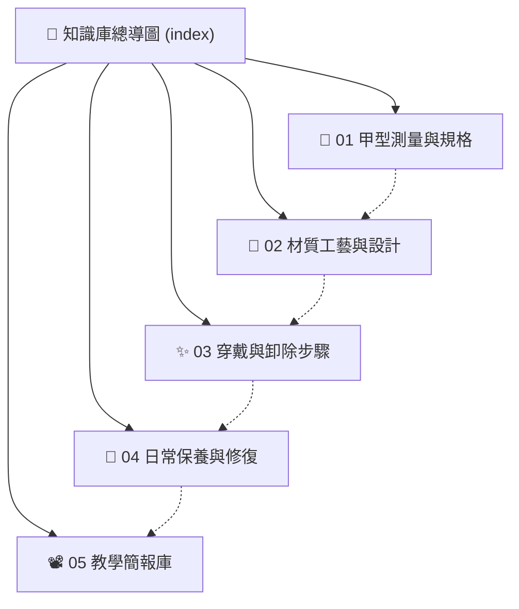

---
title: 穿戴甲客製化設計與保養知識庫 總導圖
category: 知識庫總覽
tags:
  - MOC
  - 穿戴甲
  - 目錄導航
created: 2026-11-23
updated: 2026-11-23
---

# 💅 穿戴甲客製化設計與保養知識庫 (Master MOC)

歡迎來到「穿戴甲客製化設計與保養」LLM Wiki 知識庫！本知識庫依據穿戴甲全生命週期構建，採用原子化筆記與雙向連結，可靈活索引並直接組裝輸出為「教學 HTML 簡報」。

> 系統規範與維護指南請參閱：[[agent.md]]

---

## 🗺️ 知識庫核心模組導圖 (MOCs)

### 1. [[MOC_甲型與尺寸]]
- 涵蓋真甲尺寸測量、標準碼數對照（XS～L）、常見甲型特性（中梯、杏仁、短橢圓、方型）與弧度打磨適應。

### 2. [[MOC_設計與工藝]]
- 涵蓋貓眼膠磁吸技法（寬貓眼、斜線、玻璃珠）、油畫風堆疊、十指主次視覺配置、3D 立體浮雕與法式金邊。

### 3. [[MOC_穿戴與卸除]]
- 涵蓋果凍膠與固態膠雙方案操作規範、兩者耐用度與優缺點比較表、溫水木棒卸甲與解膠劑安全拆除技巧。

### 4. [[MOC_日常保養與修復]]
- 涵蓋配戴後「黃金 4 小時」防護、日常家事防水原則、真甲受損滋養修護（指緣油/硬甲油）及甲片重複收納避光規範。

### 5. [[MOC_教學簡報庫]]
- 整合上述模組內容，原生相容 Marp 投影片語法，提供一鍵轉譯 HTML 教學簡報的來源腳本與素材。

---

## 📌 快速檢索索引
- **新手必看**：[[甲面尺寸測量法]]、[[果凍膠特性與操作規範]]、[[貼合後黃金4小時維護]]
- **美甲師/設計師**：[[油畫風堆疊與色彩學]]、[[十指配置與主次焦點設計]]、[[貓眼膠光澤與磁吸技巧]]
- **日常維護與卸除**：[[安全卸甲與除膠步驟]]、[[卸甲後真甲修復與滋養]]、[[穿戴甲清潔與避光保存]]
- **教學輸出**：[[穿戴甲客製化設計與日常保養教學_Marp]]
