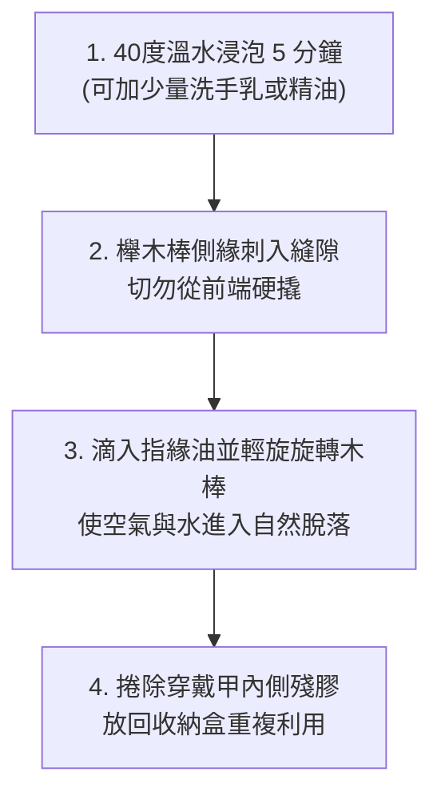

---
title: 安全卸甲與除膠步驟
category: 穿戴與卸除步驟
tags:
  - 穿戴甲
  - 安全卸甲
  - 溫水浸泡
  - 解膠劑
moc: "[[MOC_穿戴與卸除]]"
slide_ready: true
summary: 詳解果凍膠溫水木棒旋轉卸除法與固態膠解膠劑軟化無痛拆卸SOP
created: 2026-11-23
updated: 2026-11-23
---

> 上層主題：[[MOC_穿戴與卸除]] | 總目錄：[[index]]

# 安全卸甲與除膠步驟

卸甲是保護原生甲健康最關鍵的一環。**「暴力硬撕」是真甲分層斷裂的元兇**，務必依照標準 SOP 安全卸除。

![[removal_care.png]]

---

## 1. 果凍膠安全拆卸 SOP（無損保甲）

1. **溫水浸泡**：準備一碗約 40 度的溫熱水，滴入少許洗手乳或沐浴乳，雙手浸泡 5 分鐘軟化膠體。
2. **木棒尋找縫隙**：拿取斜頭櫸木棒，從穿戴甲側邊甲溝縫隙輕輕探入。
3. **旋轉分離**：在縫隙處滴入一滴指緣油提供潤滑，慢慢以打圈旋轉方式推進櫸木棒，果凍膠會順勢剝離脫落。
4. **清潔甲片**：用手將甲片背面的殘留果凍膠捲起撕下，穿戴甲完好如新。

---

## 2. 固態膠解膠劑卸除 SOP

1. **接縫滴入專用解膠劑**：在穿戴甲根部與兩側邊緣縫隙，大量滴入美甲專用解膠劑 (Debonder)。
2. **靜置軟化**：靜置停留 **2 ~ 3 分鐘**，讓化學解膠成分滲透並溶解固化的凝膠。
3. **分段輕推**：用櫸木棒從兩側翹開一點縫隙後，再次滴入解膠劑，逐步由兩側往中心推進分離。
4. **殘膠清理**：真甲上殘餘的少量膠質，使用海綿拋光條輕輕打磨即可去除。

> [!CAUTION]
> 無論使用何種膠體，感覺有明顯拉扯疼痛感時，代表膠體尚未完全軟化，應立即停止並重新浸泡或補滴解膠劑！

---

## 相關筆記
- [[卸甲後真甲修復與滋養]]
- [[果凍膠與固態膠評估對比]]
- [[穿戴甲清潔與避光保存]]
