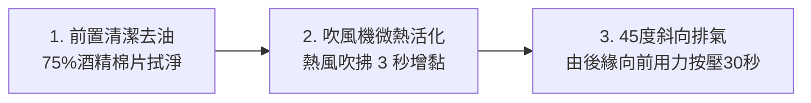

---
title: 果凍膠特性與操作規範
category: 穿戴與卸除步驟
tags:
  - 穿戴甲
  - 果凍膠
  - 佩戴步驟
  - 無損佩戴
moc: "[[MOC_穿戴與卸除]]"
slide_ready: true
summary: 掌握果凍膠前置去油去水、微熱活化與 45 度排氣按壓標準步驟
created: 2026-11-23
updated: 2026-11-23
---

> 上層主題：[[MOC_穿戴與卸除]] | 總目錄：[[index]]

# 果凍膠特性與操作規範

果凍膠（Jelly Stickers / Adhesive Tabs）是穿戴甲最受歡迎的佩戴介質，具備極高彈性與完全不傷真甲的特性。

![[jelly_sticker.jpg]]

---

## 1. 果凍膠基本特性
- **維持天數**：約 **3 ~ 7 天**（視個人活動頻率與貼合手法而定）。
- **核心優勢**：
  - 100% 不傷原生甲表面角質。
  - 穿戴甲卸下後可無限次重複佩戴。
  - 操作零技巧門檻、無化學刺鼻氣味。
- **最佳適用場景**：週末聚會出遊、拍照攝影、學生上班族平日無法留指甲者。

---

## 2. 佩戴關鍵標準三步驟 (SOP)

1. **徹底前置去油去水**：
   - 佩戴前徹底洗手並擦乾。
   - 使用 75% 酒精棉片多次擦拭真甲甲面與兩側甲溝，帶走油脂與水分。
2. **吹風機微熱活化膠體**：
   - 將尺寸適中的果凍膠貼於真甲上。
   - 使用吹風機微溫暖風輕吹 **3 秒**，可迅速激發壓敏膠分子的活性與黏著力。
3. **45 度角斜向貼合與排氣**：
   - 撕去果凍膠表面保護薄膜。
   - 穿戴甲甲根部以 **45 度角** 對準指緣甘皮前 1mm 處。
   - 由後向前緩慢下壓，並用力按壓中心與邊緣 **30 秒**，徹底擠出內部空氣。

> [!WARNING]
> 佩戴完成後請務必嚴格遵守 [[貼合後黃金4小時維護]]，4 小時內切勿接觸水分。

---

## 相關筆記
- [[固態膠黏貼指南]]
- [[果凍膠與固態膠評估對比]]
- [[貼合後黃金4小時維護]]
- [[安全卸甲與除膠步驟]]
