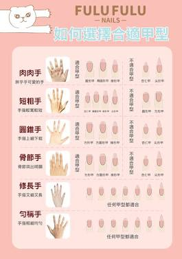
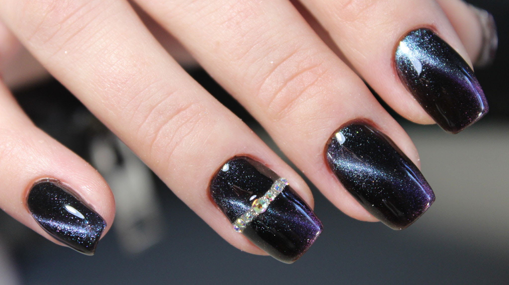
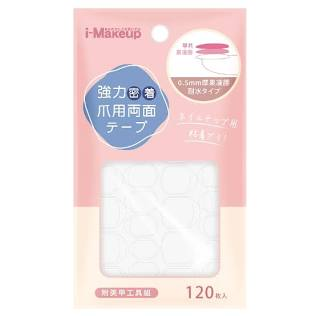
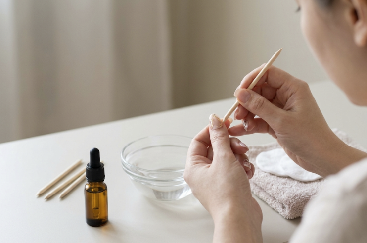
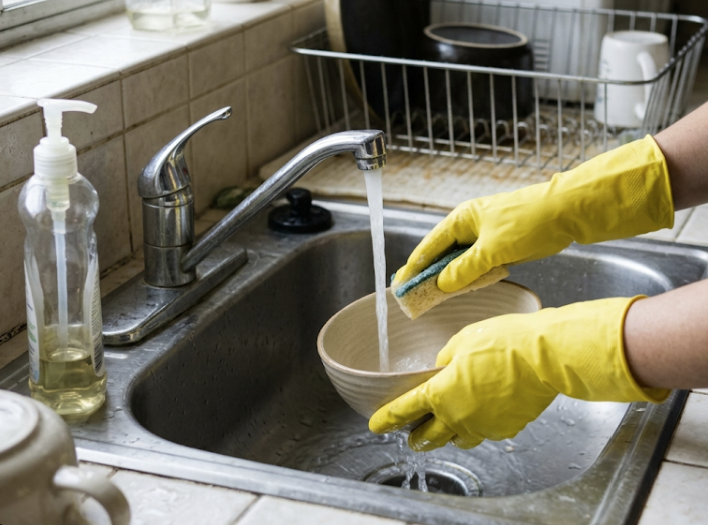

---
marp: true
theme: gaia
_class: lead
paginate: true
backgroundColor: #fffafa
color: #2b2b2b
size: 16:9
header: "💅 穿戴甲客製化設計與日常保養教學課程"
footer: "Nail Care & Press-on Wiki | 穿戴甲知識庫"
style: |
  section {
    font-family: 'PingFang TC', 'Microsoft JhengHei', sans-serif;
    padding: 40px 60px;
  }
  h1 {
    color: #b03060;
  }
  h2 {
    color: #4a4a4a;
    border-bottom: 2px solid #f3c2d1;
    padding-bottom: 8px;
  }
  table {
    font-size: 22px;
  }
  th {
    background-color: #f7d6e0;
    color: #4a4a4a;
  }
  .highlight {
    background-color: #fdf0f4;
    border-left: 6px solid #b03060;
    padding: 12px 20px;
    border-radius: 4px;
    margin-top: 15px;
  }
---

<!-- _class: lead -->
# 💅 穿戴甲客製化設計與保養全攻略
### 指尖藝術的極致享受：從精準訂製到長效呵護

**主講人**：專業美甲美學講師
**課程目標**：學會挑選專屬甲型、解析美甲工藝、掌握無損穿戴與沙龍級居家保養

<!-- note: 各位學員好，歡迎參加今天的穿戴甲全方位教學課程。今天我們將從甲型規格、工藝美學、配戴操作到日常養護，全方位揭密如何把穿戴甲戴得舒服、牢固又健康。 -->

---

## 📌 今日課程大綱

1. **單元一**：精準測量與專屬甲型挑選指南
2. **單元二**：客製化設計美學與工藝亮點
3. **單元三**：果凍膠 vs 固態膠 雙方案配戴深度解析
4. **單元四**：無損安全卸甲 SOP 與防暴拆原則
5. **單元五**：貼合後黃金 4 小時與居家防水維護
6. **單元六**：原生甲深層滋養修護與甲片重複保存

<!-- note: 整個課程約40分鐘，理論與實務並重，大家隨時可以做筆記。 -->

---

## 單元一：真甲弧度軟尺測量法

- **核心原則**：精準測量原生甲最寬處（中段甲床弧度）。
- **步驟 1**：軟尺緊貼甲面弧度，從左側甲溝量至右側甲溝。
- **步驟 2**：記錄大拇指至小指之毫米數（如 `15-11-12-11-8`）。
- **「寧大勿小」原則**：尺寸介於兩碼之間時務必選大一號！

💡 稍大的甲片可用砂條打磨微調，過小甲片會壓迫甲床產生疼痛。

<!-- note: 測量時一定要使用柔軟的量甲尺貼著弧度量，千萬不能用硬直尺凌空比對，否則量出來的數值會比實際小很多。 -->

---

## 單元一：四大主流甲型與修飾效果

- **中梯形 (Medium Coffin)**
  - 視覺無限拉長手指，歐美高級感首選。
- **杏仁型 (Almond)**
  - 尖端圓潤優雅，最適合貓眼與溫柔暈染。
- **短橢圓 (Short Oval)**
  - 最貼近真甲，日常辦公完全不卡手。
- **方形 (Square)**
  - 俐落有個性，甲面平整最適彩繪創作。

<!-- note: 杏仁型最修飾肉肉手或指節偏大的手型，如果第一次嘗試，非常推薦先從小杏仁或短橢圓入手。 -->

---

## 單元二：貓眼膠光影與磁吸工藝

- **寬貓眼 (Wide Cat-eye)**
  - 四角向中心推磁，形成面狀通透絲緞高光。
- **斜線貓眼 (Diagonal Cat-eye)**
  - 45 度條形磁吸，收束出俐落靈動光帶。
- **玻璃珠貓眼 (Glass Bead)**
  - 磁鐵環形繞圈引導，晶瑩水晶球立體光斑。

<!-- note: 貓眼膠的精髓在於推磁的速度與距離，距離甲面3mm處操作是最佳磁場控制點。 -->

---

## 單元二：十指視覺構圖與焦點配置

合理的視覺流動，是穿戴甲高級質感的秘密：

- **👑 主焦點（食指 / 無名指）**
  - 精緻手繪油畫、3D 立體浮雕、奢華排鑽。
- **✨ 次焦點（大拇指 / 中指）**
  - 高透貓眼光影、極細 1mm 法式金邊勾勒。
- **🍃 陪襯指（小指）**
  - 簡約純色跳色、微透薄塗留白，避免視覺雜亂。

🎨 全手配色掌握「不超過三種核心主色」，保持色系冷暖調統一。

<!-- note: 切記不要十指都畫得密密麻麻，適度的留白才能凸顯主焦點的精緻度。 -->

---

## 單元三：果凍膠 vs 固態膠 評估比較

| 評估維度 | 果凍膠 (Jelly Sticker) | 固態 UV 膠 (Solid Gel) |
| :--- | :--- | :--- |
| **維持時間** | 3 ～ 7 天 | 14 ～ 30 天 |
| **防水等級** | 中等（防短時間洗手） | 極高（可洗碗泡澡） |
| **真甲損耗** | **0%（完全無損）** | 輕微（需拋磨抓力） |
| **拆卸難度** | 溫水泡 5 分鐘即拆 | 需使用專用解膠劑 |
| **甲片重複** | **可無限次重複佩戴** | 甲片易磨損殘留 |

<!-- note: 如果是週末要出遊或是買了高單價的手工甲，果凍膠是最佳夥伴；若是想要出國玩幾週不操心，固態膠更穩固。 -->

---

## 單元三：果凍膠標準佩戴三部曲

1. **酒精去油去水**
   - 75% 酒精棉片徹底拭淨真甲甲面與甲溝粉塵油脂。
2. **吹風機微熱活化**
   - 貼上果凍膠後，用吹風機溫風微吹 3 秒激發黏性分子。
3. **45 度斜向排氣按壓**
   - 甲片由後緣 45 度推入，由後往前用力按壓 30 秒徹底排氣。

⚠️ 佩戴後請記住「黃金 4 小時」絕對不能碰水與洗手！

<!-- note: 這三步驟是果凍膠能戴滿一週的關鍵秘訣，特別是45度角貼入能完美避免後緣氣泡。 -->

---

## 單元四：安全卸甲 SOP（切勿暴力硬扯）

### 💧 果凍膠無損拆卸法
1. 浸泡 40 度溫水 + 洗手乳約 5 分鐘。
2. 用斜頭櫸木棒從**「側邊甲溝縫隙」**輕輕刺入。
3. 滴入指緣油潤滑，以**打圈旋轉方式**推開膠體。
4. 捲除甲片背面殘膠，放回收納盒。

> **嚴禁**：直接從指尖由前往後硬掰，會導致真甲表層角質分層撕裂！

<!-- note: 很多人因為暴力拔下穿戴甲導致真甲發白受損，只要花五分鐘泡溫水，就能完好無損地取下。 -->

---

## 單元五：日常居家防護四大習慣

1. **洗滌必備防水手套**
   - 家事洗碗精等介質會迅速乳化膠體。
2. **避開高溫熱水浸泡**
   - 泡湯、長時間洗熱水澡會使膠體變軟。
3. **改用「指腹」代替指尖**
   - 打字、按按鈕改用第一指節指腹發力。
4. **睡前佩戴效果最佳**
   - 貼完立即入睡，完美度過無水密合期。

<!-- note: 習慣改變是美甲持久的核心，指腹用力不僅能保護甲片，還能避免指關節挫傷。 -->

---

## 單元六：真甲修復與甲片收納

- **卸甲後滋養三部曲**：
  1. **拋光條平整**：海綿條畫圓輕撫甲面去除殘痕。
  2. **指緣油深層滋養**：滴上維生素 E 指緣油按摩吸收。
  3. **蛋白質硬甲油防護**：薄軟甲可連塗一週強化甲質。
- **穿戴甲保存原則**：
  - 酒精拭淨背面殘膠與油脂。
  - 黏貼於專用收納盒，**避光陰涼存放**防止 UV 使凝膠黃化。

<!-- note: 定期給指甲放假1到2天，期間多補充指緣油，指甲就會維持粉嫩健康的自然光澤。 -->

---

<!-- _class: lead -->
# 💖 讓指尖美學成為日常的精緻陪伴

### 感謝您的聆聽與參與！
**Q & A 交流時間**

知識庫維護與簡報源文件請參見：`[[MOC_教學簡報庫]]` / `[[index]]`
